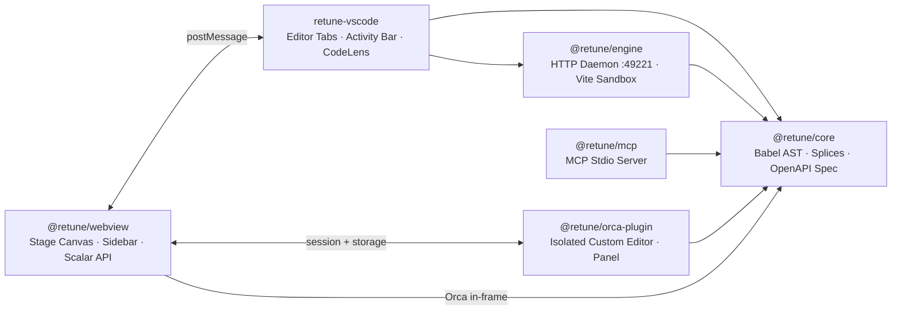

<p align="center">
  
</p>

<p align="center">
  
</p>

<h1 align="center">Retune</h1>

<p align="center">
  <strong>Zero-config visual component tuner, non-lossy AST engine, and OpenAPI console for React, Tailwind CSS, CVA, VS Code, Orca, and AI agents.</strong>
</p>

<p align="center">
  <a href="https://github.com/Traves-Theberge/Retune/actions/workflows/ci.yml"></a>
  <a href="./LICENSE"></a>
  
  
  
  
  
</p>

<p align="center">
  <code>react</code> · <code>tailwind-css</code> · <code>shadcn-ui</code> · <code>cva</code> · <code>ast-refactoring</code> · <code>vscode-extension</code> · <code>orca-plugin</code> · <code>mcp-server</code> · <code>openapi</code> · <code>design-tools</code>
</p>

---

## Overview

**Retune** bridges the gap between design-tool velocity and clean hand-written React code. Instead of maintaining proprietary preview files or letting a visual editor reformat your components, Retune parses your live `.tsx` / `.jsx` source directly with `@babel/parser`, lets you visually manipulate elements, spacing, colors, states, and `cva()` variants inside **The Stage**, and writes every change back as minimal byte-range splices (`TextEdit`) that preserve your comments, imports, quotes, and dynamic helpers like `cn()`, `clsx()`, and `twMerge()`.

---

## What It Does

### 1. Interactive Visual Stage (`@retune/webview`)
- **Multi-Element JSX Tree Preview**: Parses returned JSX hierarchies into an interactive [`PreviewNode`](./packages/core/src/ast/jsx-mutator.ts) tree so nested child elements render cleanly and can be clicked directly on the canvas to focus and tune.
- **Direct Box-Model Manipulation**: Selecting any element reveals an outline, `<tag>` chip, dimension badge, corner guides, and draggable **width (`w-[Npx]`)** and **height (`h-[Npx]`)** resize handles.
- **Floating Selection Toolbar & Popovers**: Click an element for quick access to **Text**, **Fill**, **Type**, **Space**, **Shape**, **Variants**, and **Classes** popovers that auto-clamp and flip inside the viewport. Double-click edits label/state inline; right-click opens the context action menu.
- **Pseudo-State Simulator**: Toggle **`Base`**, **`:hover`**, **`:focus`**, or **`:active`** in the Canvas Dock or Sidebar to preview and edit state-prefixed classes (`hover:*`, `focus-visible:*`, `active:*`) live without holding pointer hover.
- **Variant Matrix View**: Toggle **Variant Matrix** to render the Cartesian grid of your `cva()` variant combinations simultaneously and click any cell to inspect or edit it.
- **Live Accessibility HUD**: Computes real **WCAG 2.1 contrast ratios** (`AAA`, `AA`, `AA Large`, `Low`) and flags **`< 44px` touch targets** from resolved runtime styles.
- **Viewport & Backdrop Controls**: Switch between **Fluid**, **Mobile (`375px`)**, **Tablet (`768px`)**, and **Desktop (`1024px`)**, toggle the fading alignment dot-grid, and flip between dark and light canvas backdrops.

### 2. Dockable Inspector Sidebar & Editor Sync
- **8 Structured Inspector Sections**: **Element** (clickable tree with line numbers & class counts), **Content**, **Variants** (`edit` variant classes in place, **`+`** add a brand-new named variant, or `set default`), **Layout** (scrubbable spacing & sizing), **Typography**, **Appearance** (color pickers, swatches, radius, elevation, opacity), **Classes** (tag chips + arbitrary Tailwind input), and **Workspace**.
- **Bidirectional Cursor Sync**: Moving your cursor inside a JSX element in the editor automatically selects that element on The Stage; selecting an element in the Inspector reveals its source line.
- **Safe Editing & History**: Includes a 100-step **Undo / Redo** stack (`Ctrl/Cmd+Z`, `Ctrl/Cmd+Shift+Z`, `Ctrl/Cmd+Y`), **Hold-to-Compare** against the saved file, **Discard**, and one explicit **Sync** (`Ctrl/Cmd+S`). Syntax errors surface in a non-blocking banner while preserving your last good preview.

### 3. Non-Lossy Minimal-Splice AST Engine (`@retune/core`)
- Computes surgical `TextEdit` byte ranges rather than reprinting the AST.
- Preserves comments, indentation, single vs. double vs. backtick quotes, TypeScript generic arguments, dynamic expressions inside `cn()` / `clsx()` / `twMerge()` / `cx()`, and template literal interpolations.
- Reads and mutates JSX `className` attributes, `cva()` base classes, `cva().variants[group][key]`, and `cva().defaultVariants`.

### 4. Multi-Host Ecosystem (`retune-vscode`, `@retune/orca-plugin`, `@retune/mcp`, `@retune/engine`)
- **VS Code & Antigravity IDE Extension (`retune-vscode`)**: Opens as a Split Editor beside code or full Editor Tab, docks into the Activity Bar, and attaches CodeLenses + right-click context menus to every component.
- **Orca Plugin (`@retune/orca-plugin`)**: Format 2 (`sandboxed-ui`) plugin contributing an isolated `.tsx`/`.jsx` **Retune** custom editor toggle beside Source plus a synchronized **Retune Inspector** right-sidebar panel using zero-network in-frame Babel analysis.
- **MCP Server (`@retune/mcp`) & HTTP Daemon (`@retune/engine`)**: Exposes component AST inspection, element listing, preview trees, and targeted class/CVA variant mutations over stdio (Model Context Protocol) and localhost HTTP (`127.0.0.1:49221`) with an embedded **Scalar OpenAPI 3.1** reference console.

---

## Architecture & Monorepo Layout



```text
Retune/
├── docs/assets/                  # Brand logo & banner assets
├── examples/                     # Sample components (e.g., Button.tsx) for testing
├── packages/
│   ├── core/                     # @retune/core — AST analyzers, minimal splicers & OpenAPI 3.1 spec
│   ├── engine/                   # @retune/engine — HTTP daemon (:49221) & Vite module resolver
│   ├── webview/                  # @retune/webview — React 19 UI, Stage, Sidebar & Scalar console
│   ├── mcp/                      # @retune/mcp — Model Context Protocol (MCP) stdio server
│   ├── orca-plugin/              # @retune/orca-plugin — Orca (onorca.dev) Format 2 plugin
│   └── vscode-extension/         # retune-vscode — VS Code & Antigravity IDE extension
├── turbo.json                    # Turborepo pipeline configuration
└── pnpm-workspace.yaml           # pnpm workspace definition
```

| Package | Role | Key Exports / Entrypoints |
| :--- | :--- | :--- |
| [`@retune/core`](./packages/core) | AST engine & OpenAPI spec | `extractCvaMetadata`, `analyzeProps`, `extractComponentName`, `extractPreviewTree`, `listElements`, `computeClassNameEdit`, `computeCvaBaseEdit`, `computeCvaVariantEdit`, `computeDefaultVariantEdit`, `openApiSpec` |
| [`@retune/engine`](./packages/engine) | Local HTTP API & Vite sandbox | `createRetuneDaemon(port = 49221)`, `createSandboxViteServer`, `resolveWorkspaceAlias` |
| [`@retune/webview`](./packages/webview) | Stage & Inspector React UI | Dual-mode UI (`editor-tab` & `sidebar`), VS Code & Orca host adapters, WCAG/a11y helpers, lazy-loaded Scalar console |
| [`@retune/mcp`](./packages/mcp) | AI Agent MCP server | `retune_inspect_component`, `retune_fine_tune_classes`, `retune_mutate_cva_variant` |
| [`@retune/orca-plugin`](./packages/orca-plugin) | Orca (`onorca.dev`) Format 2 plugin | `orca-plugin.json`, `retune-stage` custom editor, `retune-inspector` panel |
| [`retune-vscode`](./packages/vscode-extension) | VS Code / Antigravity extension | `StagePanel`, `RetuneSidebarProvider`, `RetuneCodeLensProvider`, VSIX local installer |

---

## How to Use It

### Prerequisites
- **Node.js** `>= 20.0.0`
- **pnpm** `>= 9.0.0`
- **VS Code** `>= 1.90.0` or **Antigravity IDE** (for IDE extension)
- **Orca** `>= 1.4.248` (optional, for running the Orca plugin)

### 1. Install, Build & Test the Workspace

```bash
# Install dependencies across all 6 workspace packages
pnpm install

# Build all packages, generate offline Orca entries, and package/install the VSIX
pnpm build

# Run the full Vitest suite across all packages
pnpm test

# Typecheck all packages
pnpm lint
```

### 2. Use in VS Code & Antigravity IDE
Building the workspace automatically packages `packages/vscode-extension/retune-vscode-1.0.0.vsix` and installs it into `.antigravity-ide/extensions`, `.antigravity/extensions`, and `.vscode/extensions` on Windows (or press **`F5`** in VS Code to launch the Extension Development Host).

- Open any `.tsx` / `.jsx` component (such as [`examples/Button.tsx`](./examples/Button.tsx)).
- **Open The Stage**: Press **`Ctrl+Shift+R`** (`Cmd+Shift+R` on macOS), right-click anywhere in a component and pick **Retune: Tune Component in Stage**, click an inline **CodeLens** above a component or `cva()` call, or click the Retune icon in the Activity Bar.
- **Edit & Sync**: Click an element on The Stage or pick it in the Sidebar, tune tokens/variants/states, and press **`Ctrl+S`** (`Cmd+S`) or click **Sync** to write minimal edits into your file.

<details>
<summary><strong>VS Code Extension Settings (<code>retune.*</code>)</strong></summary>

| Setting | Type | Default | Description |
| :--- | :--- | :--- | :--- |
| `retune.stage.openMode` | `"split" \| "tab"` | `"split"` | Open Retune Stage beside the active code editor or in a full tab. |
| `retune.stage.defaultViewport` | `"responsive" \| "mobile" \| "tablet" \| "desktop"` | `"responsive"` | Default viewport preset on The Stage canvas. |
| `retune.stage.showGrid` | `boolean` | `true` | Render the dot alignment grid on The Stage canvas. |
| `retune.autoSyncActiveEditor` | `boolean` | `true` | Sync Stage and Sidebar selection with the active `.tsx`/`.jsx` file & cursor. |
| `retune.daemon.port` | `number` | `49221` | Port for the local Retune AST & OpenAPI HTTP daemon. |
| `retune.sandbox.port` | `number` | `5173` | Port for the standalone Webview Vite dev server. |
| `retune.scalar.layout` | `"modern" \| "classic"` | `"modern"` | Layout theme for the embedded Scalar OpenAPI console. |

</details>

### 3. Use as an Orca (`onorca.dev`) Plugin
1. Build the plugin webview assets:
   ```bash
   pnpm build
   ```
2. Validate the Format 2 manifest and isolated editor bundle offline:
   ```bash
   orca plugin validate packages/orca-plugin
   orca plugin check packages/orca-plugin
   ```
3. Launch **Orca**, enable plugins under **Settings → Plugins**, and load the local development plugin (approving the `sandboxed-ui` + `settings:own` + `storage:own` prompt):
   ```bash
   orca plugin dev load packages/orca-plugin
   ```
4. Open any `.tsx` or `.jsx` file in Orca, switch the tab view toggle beside **Source** to **Retune**, and toggle **Retune Inspector** in the right sidebar with **`Mod+Shift+R`**.

### 4. Use Standalone Browser Mode & Scalar API Console
Run the HTTP AST daemon and Vite Webview server independently:

```bash
pnpm --filter @retune/engine start
pnpm --filter @retune/webview dev
```

- **Visual Stage & Sidebar UI**: `http://localhost:5173`
- **OpenAPI 3.1 Spec**: `GET http://127.0.0.1:49221/v1/openapi.json`
- **Inspect Source**: `POST http://127.0.0.1:49221/v1/components/inspect` (`{ fileContent }`) -> returns `{ cva, props, elements, previewTree }`
- **Mutate Source**: `POST http://127.0.0.1:49221/v1/components/mutate` (`{ fileContent, componentName, targetIndex, cvaBase, cvaVariant, defaultVariant, className }`)

### 5. Use with AI Agents via MCP (`@retune/mcp`)
Register the built MCP server with Antigravity or any MCP client:

```bash
agy mcp add retune node "c:/path/to/Retune/packages/mcp/dist/index.js"
```

```json
{
  "mcpServers": {
    "retune": {
      "command": "node",
      "args": ["/absolute/path/to/Retune/packages/mcp/dist/index.js"]
    }
  }
}
```

| MCP Tool | Purpose |
| :--- | :--- |
| `retune_inspect_component` | Extracts `cva` variants, TypeScript `props`, indexed JSX `elements`, and `previewTree` from a `.tsx` file. |
| `retune_fine_tune_classes` | Applies non-lossy `className` edits to a component, Nth `targetIndex` element, or `cvaBase`. |
| `retune_mutate_cva_variant` | Updates or creates a named entry in `cva().variants[group]` and optionally updates `defaultVariants`. |

---

## How to Contribute

Contributions are welcome! Please read [CONTRIBUTING.md](./CONTRIBUTING.md) before opening a pull request.

1. Keep [`@retune/core`](./packages/core) free of Node-specific I/O (`fs`, `path`) or VS Code imports inside browser-shared AST modules (`ast/*`) so it continues to bundle cleanly into both Node tools and Orca's browser sandbox.
2. Follow the design-token discipline in [`packages/webview`](./packages/webview): always use semantic utilities (`bg-panel`, `text-fg`, `border-line`, `bg-accent`) rather than raw Tailwind color scales (`zinc-*`, `indigo-*`) or hex literals—enforced automatically by `palette-sweep.test.ts`.
3. Ensure every check passes locally before submitting:
   ```bash
   pnpm build && pnpm test && pnpm lint
   orca plugin validate packages/orca-plugin && orca plugin check packages/orca-plugin
   ```

---

## Changelog & License

- See [CHANGELOG.md](./CHANGELOG.md) for release notes and unreleased changes.
- Released under the [MIT License](./LICENSE).
