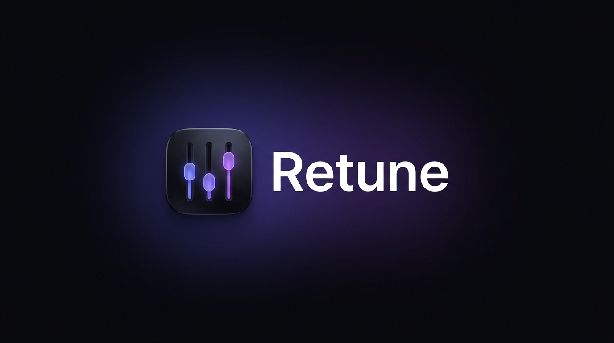

<p align="center">
  
</p>

<p align="center">
  <strong>Visually edit your React and Tailwind CSS components and save changes straight to your code.</strong>
</p>

<p align="center">
  <a href="https://github.com/Traves-Theberge/Retune/actions/workflows/ci.yml"></a>
  <a href="./LICENSE"></a>
  
  
  
</p>

<p align="center">
  <code>react</code> · <code>tailwind-css</code> · <code>shadcn-ui</code> · <code>cva</code> · <code>visual-editor</code> · <code>vscode-extension</code> · <code>orca-plugin</code> · <code>mcp</code>
</p>

---

Styling React components usually means changing a class name in your editor, switching to the browser to see how it looks, and repeating that loop dozens of times. Other visual tools often ask you to maintain separate preview files or reformat your whole file when you save.

**Retune** opens your `.tsx` and `.jsx` files on a live visual canvas right next to your code. Whether you're working on a single button, an SVG illustration, or a full page, you can click any element to adjust its layout, spacing, text, colors, states, or variants visually. When you press save, Retune updates only the classes you changed and leaves your formatting, comments, imports, and `cn()` / `clsx()` helpers untouched.

---

## What It Does

### 1. Edit Directly on the Canvas
- **Click any element**: Open any `.tsx` or `.jsx` component or page and click any element on the canvas to select and style it.
- **Drag to resize & edit text**: Drag the side and bottom handles on a selected element to resize width and height, double-click text to edit labels in place, or right-click for quick actions.
- **Quick popovers**: Click **Text**, **Fill**, **Type**, **Space**, **Shape**, **Variants**, or **Classes** in the floating toolbar above the selected element to make changes without leaving the canvas.
- **Screen sizes & backgrounds**: Preview your work at **Fluid**, **Mobile (`375px`)**, **Tablet (`768px`)**, or **Desktop (`1024px`)** widths, toggle the alignment grid, and switch between dark and light canvas backgrounds.

### 2. Fine-Tune Styles, States & Variants
- **Inspector sidebar**: Adjust layout, spacing, font size, weight, colors, rounded corners, shadows, and opacity using visual controls—or add and remove Tailwind classes directly.
- **Preview `:hover`, `:focus`, and `:active` states**: Flip between **Base**, **:hover**, **:focus**, and **:active** with one click so you can style interactive states without holding your mouse over the element.
- **Edit `cva()` variants & Variant Matrix**: Switch between variants live, edit a variant's classes, click **`+`** to create a new variant, change the default variant, or open the **Variant Matrix** to compare every variant combination side by side.
- **Built-in accessibility checks**: Live badges show contrast grades (`AAA`, `AA`, `AA Large`, `Low`) and warn you when interactive elements are smaller than the `44px` touch target minimum.

### 3. Save Clean Code Without Losing Formatting
- **Synced with your editor cursor**: Click inside an element in your code editor to select it on the canvas, or pick an element in Retune to jump straight to that line in your file.
- **Undo, compare & save**: Step backward and forward through 100 levels of **Undo / Redo** (`Ctrl+Z` / `Cmd+Z`), hold **Compare** to see your saved version, **Discard** unsaved tweaks, and press **`Ctrl+S`** (`Cmd+S`) or click **Sync** when you're ready to write to disk.
- **Clean diffs**: Retune only edits the class names or variant strings you touched. It never reformats your file or strips your comments.

### 4. Works in VS Code, Orca, Your Browser & AI Assistants
- **VS Code & Antigravity IDE**: Open Retune beside your code in a split pane, in a full editor tab, or in the Activity Bar sidebar.
- **Orca**: Switch any `.tsx` or `.jsx` tab from **Source** to **Retune** and open the **Retune Inspector** in the right sidebar (`Ctrl+Shift+R` / `Cmd+Shift+R`).
- **Browser & AI Assistants**: Run Retune in your browser or connect it to AI coding tools via MCP so your assistant can inspect and style components for you.

---

## How to Use It

### In VS Code & Antigravity IDE
Building the workspace installs the extension into VS Code and Antigravity IDE automatically (or press **`F5`** in VS Code to launch an Extension Development Host).

1. Open any `.tsx` or `.jsx` file (such as [`examples/Button.tsx`](./examples/Button.tsx)).
2. Open Retune in any of four ways:
   - Press **`Ctrl+Shift+R`** (`Cmd+Shift+R` on macOS).
   - Click the **Retune** link that appears directly above a component or `cva()` definition.
   - Right-click anywhere in a component and choose **Retune: Tune Component in Stage**.
   - Click the **Retune** icon in the Activity Bar.
3. Tune spacing, colors, states, or variants, then press **`Ctrl+S`** (`Cmd+S`) or click **Sync** to save back to your file.

<details>
<summary><strong>Extension Settings (<code>retune.*</code>)</strong></summary>

| Setting | Type | Default | Description |
| :--- | :--- | :--- | :--- |
| `retune.stage.openMode` | `"split" \| "tab"` | `"split"` | Open the canvas beside your code editor or in a full tab. |
| `retune.stage.defaultViewport` | `"responsive" \| "mobile" \| "tablet" \| "desktop"` | `"responsive"` | Default width preset when opening the canvas. |
| `retune.stage.showGrid` | `boolean` | `true` | Show the background alignment grid on the canvas. |
| `retune.autoSyncActiveEditor` | `boolean` | `true` | Automatically sync the canvas when switching files or moving your cursor. |
| `retune.daemon.port` | `number` | `49221` | Port for the local background service. |
| `retune.sandbox.port` | `number` | `5173` | Port for the standalone browser preview server. |
| `retune.scalar.layout` | `"modern" \| "classic"` | `"modern"` | Layout style for the local API reference tab. |

</details>

### In Orca (`onorca.dev`)
1. Build the workspace so the plugin bundle is up to date:
   ```bash
   pnpm build
   ```
2. Open **Orca**, enable plugins under **Settings → Plugins**, and load the local plugin:
   ```bash
   orca plugin dev load packages/orca-plugin
   ```
3. Open any `.tsx` or `.jsx` file, switch the view toggle next to **Source** to **Retune**, and toggle **Retune Inspector** in the right sidebar with **`Mod+Shift+R`**.

### In Your Browser
You can run Retune outside an editor using the standalone local UI:

```bash
pnpm --filter @retune/engine start
pnpm --filter @retune/webview dev
```

Then open `http://localhost:5173` in your browser.

### With AI Assistants (MCP)
Connect Retune to Antigravity or any MCP-compatible coding assistant so it can inspect component variants and update styles on your behalf:

```bash
agy mcp add retune node "c:/path/to/Retune/packages/mcp/dist/index.js"
```

```json
{
  "mcpServers": {
    "retune": {
      "command": "node",
      "args": ["/absolute/path/to/Retune/packages/mcp/dist/index.js"]
    }
  }
}
```

| Tool | What It Lets Your Assistant Do |
| :--- | :--- |
| `retune_inspect_component` | Read a component's elements, props, and `cva()` variants from a `.tsx` file. |
| `retune_fine_tune_classes` | Update the Tailwind classes on a specific element or `cva()` base style without reformatting the file. |
| `retune_mutate_cva_variant` | Update an existing `cva()` variant, add a new one, or change the default variant. |

---

## Install & Build from Source

Prerequisites: **Node.js** `>= 20.0.0` and **pnpm** `>= 9.0.0`.

```bash
# Install dependencies
pnpm install

# Build all packages, Orca plugin assets, and the VS Code extension (.vsix)
pnpm build

# Run tests and typechecks
pnpm test
pnpm lint
```

---

## How to Contribute

Contributions are welcome! See [CONTRIBUTING.md](./CONTRIBUTING.md) for the workspace setup, architecture notes, and checklist before opening a pull request.

- See [CHANGELOG.md](./CHANGELOG.md) for release notes.
- Released under the [MIT License](./LICENSE).
